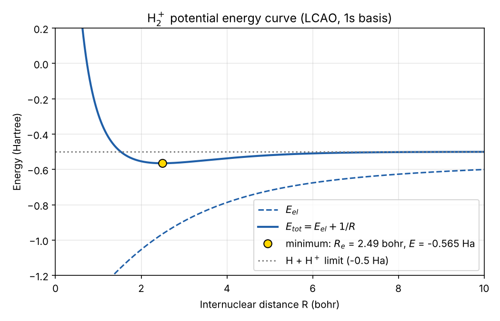

# H₂⁺ molecular ion: variational LCAO

Variational calculation of the H₂⁺ ground state in MATLAB, using a linear combination of two hydrogen 1s orbitals (LCAO).

For each internuclear distance R, the script builds the 2×2 Hamiltonian and overlap matrices from the analytic overlap, Coulomb and exchange integrals. It then solves the generalised eigenvalue problem **H c = E S c**. Adding the nuclear repulsion 1/R gives the potential energy curve, whose minimum is the equilibrium bond length.



## Results

| Quantity | LCAO (1s basis) | Exact |
| --- | --- | --- |
| Equilibrium distance R<sub>e</sub> | ≈ 2.49 bohr (1.32 Å) | 2.00 bohr (1.06 Å) |
| Binding energy D<sub>e</sub> | ≈ 1.76 eV | 2.79 eV |

The minimal basis predicts a bound molecule, but it overestimates the bond length and underestimates the binding energy. This is the variational principle at work: a restricted trial wavefunction always gives an energy above the exact one. A larger basis, such as one with a variable orbital exponent or 2p polarisation functions, brings both values closer to experiment.

## Run

```matlab
H2ion_LCAO
```

Prints R<sub>e</sub>, the minimum energy and D<sub>e</sub>, and saves the plot as `h2_ion_energy.png`.
