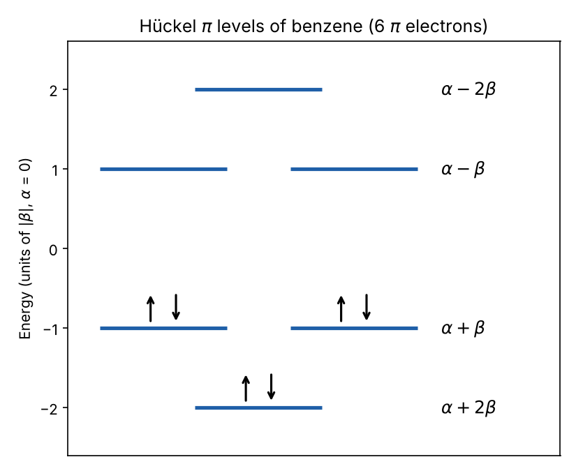

# Hückel model of benzene

Symbolic solution of the Hückel model for the π-electron system of benzene in MATLAB.

The six carbon p<sub>z</sub> orbitals form a ring. The Hamiltonian has the Coulomb integral α on the diagonal and the resonance integral β between nearest neighbours. Corner elements close the ring (periodic boundary conditions). Diagonalising the 6×6 matrix symbolically gives the molecular orbital energies and their eigenvectors.



## Results

| Energy | Degeneracy | Character |
| --- | --- | --- |
| α + 2β | 1 | bonding |
| α + β | 2 | bonding |
| α − β | 2 | antibonding |
| α − 2β | 1 | antibonding |

The 6 π electrons fill the three bonding orbitals (β < 0). That gives a total π energy of 6α + 8β, which is 2β below three localised C=C bonds (6α + 6β). This difference is the delocalisation, or aromatic stabilisation, energy of benzene.

The same matrix is a 1D tight-binding ring with N = 6. Its eigenvalues follow E<sub>k</sub> = α + 2β cos(2πk/6), the discrete version of a band structure.

## Run

```matlab
huckel_benzene
```

Requires the MATLAB Symbolic Math Toolbox.
