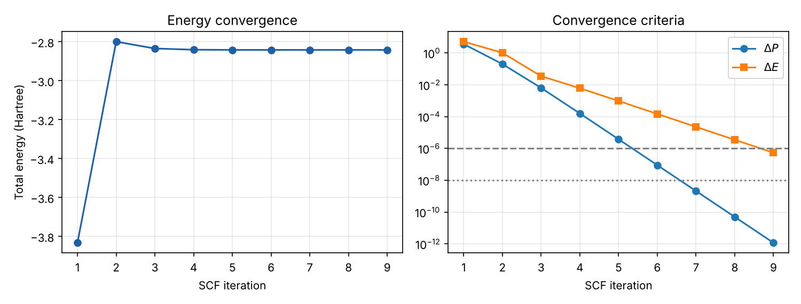

# Restricted Hartree–Fock for HeH⁺

A restricted Hartree–Fock (RHF) self-consistent field program for the HeH⁺ molecular ion in the STO-3G basis, written from scratch in Python with NumPy only.

Starting from the given one- and two-electron integrals, the notebook:

1. orthogonalises the atomic-orbital basis (X = U s−1/2), turning the Roothaan–Hall equations **F C = S C ε** into an ordinary eigenvalue problem
2. starts from the core-Hamiltonian guess (P = 0)
3. iterates Fock build → diagonalisation → new density matrix until the density and the energy converge (ΔP < 10⁻⁸, ΔE < 10⁻⁶)

## Results (R = 1.4632 bohr)

| Quantity | Value (Hartree) |
| --- | --- |
| Occupied orbital energy ε₁ | −1.6328 |
| Virtual orbital energy ε₂ | −0.1725 |
| Electronic energy | −4.20872 |
| Nuclear repulsion | 1.36685 |
| **Total SCF energy** | **−2.84187** |

The SCF converges in 9 iterations. Both orbital energies are negative because HeH⁺ is a cation: even the empty orbital is bound by the net positive charge.

## Run

Open `HeH_RHF.ipynb` in Jupyter, or view it directly on GitHub with all outputs. Requires `numpy` and `matplotlib`.
