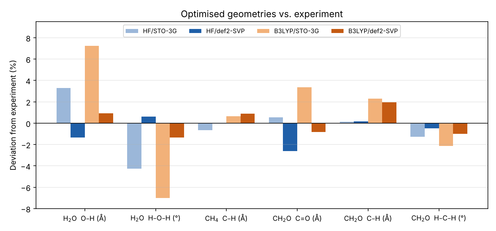

# Geometry optimisation of small molecules

H₂O, CH₄ and CH₂O optimised with ORCA using two methods (Hartree–Fock and the B3LYP hybrid functional) and two basis sets (minimal STO-3G and split-valence def2-SVP). The optimised geometries are compared with experiment.

## Optimised geometries

| Molecule | Parameter | HF/STO-3G | HF/def2-SVP | B3LYP/STO-3G | B3LYP/def2-SVP | Exp. |
| --- | --- | --- | --- | --- | --- | --- |
| H₂O | O–H (Å) | 0.989 | 0.945 | 1.028 | 0.967 | 0.958 |
| H₂O | H–O–H (°) | 100.0 | 105.1 | 97.2 | 103.1 | 104.5 |
| CH₄ | C–H (Å) | 1.083 | 1.090 | 1.097 | 1.100 | 1.09 |
| CH₄ | H–C–H (°) | 109.5 | 109.5 | 109.5 | 109.5 | 109.5 |
| CH₂O | C=O (Å) | 1.217 | 1.179 | 1.251 | 1.200 | 1.21 |
| CH₂O | C–H (Å) | 1.101 | 1.102 | 1.125 | 1.122 | 1.10 |
| CH₂O | H–C–H (°) | 114.5 | 115.4 | 113.5 | 114.8 | 116.0 |

## Total energies and cost

| Molecule | HF/STO-3G | HF/def2-SVP | B3LYP/STO-3G | B3LYP/def2-SVP |
| --- | --- | --- | --- | --- |
| H₂O (Hartree) | −74.9659 | −75.9613 | −75.2863 | −76.3213 |
| CH₄ (Hartree) | −39.7269 | −40.1692 | −40.0033 | −40.4519 |
| CH₂O (Hartree) | −112.3543 | −113.7798 | −112.8991 | −114.3563 |
| CH₂O run time (s) | 2.4 | 4.4 | 12.4 | 23.4 |

## Observations

- **Basis set matters most.** The minimal STO-3G basis gives errors of up to 7 % (B3LYP O–H bond, H–O–H angle). With def2-SVP, all bond lengths are within about 3 % and angles within 1.5° of experiment.
- **HF underestimates bond lengths** in the larger basis (H₂O O–H, CH₂O C=O). Without electron correlation, the electrons are held too tightly in the bond. B3LYP includes correlation approximately and corrects most of this.
- **Lower energy does not mean a better structure.** Total energies always drop with the larger basis (variational principle) and with B3LYP. But B3LYP/STO-3G gives the worst geometries of all four combinations.
- **Cost:** def2-SVP roughly doubles the run time, and B3LYP is 3–5 times slower than HF because of the numerical integration grid for the exchange–correlation functional.
- CH₄ keeps its ideal tetrahedral angle (109.47°) at every level, as fixed by symmetry.

## Files

`*.xyz`: starting structures · `*.out`: full ORCA output (input, SCF, optimisation, final geometry)
