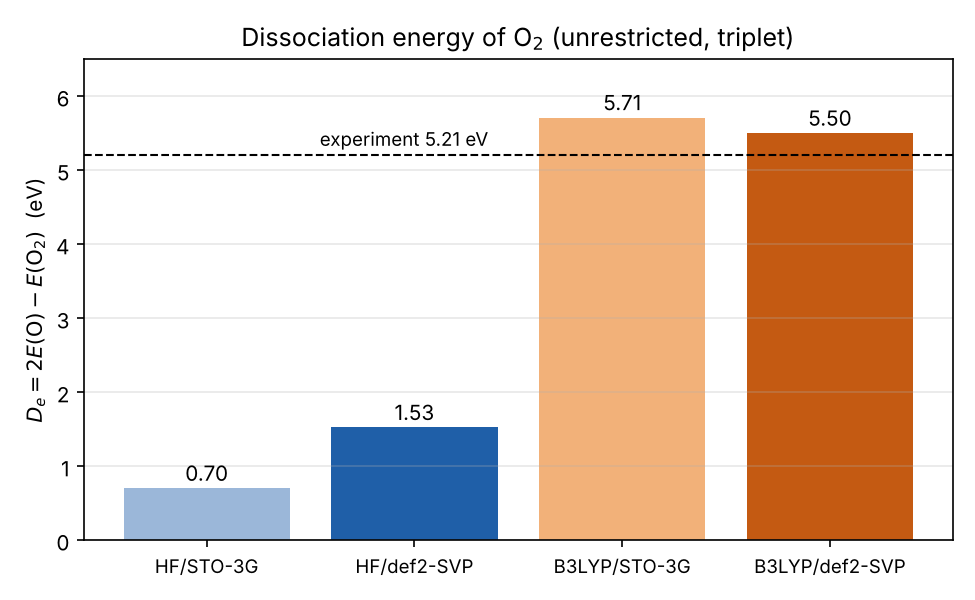

# Dissociation of molecular oxygen

The dissociation energy of O₂ → 2 O computed with ORCA, using unrestricted Hartree–Fock and unrestricted B3LYP in two basis sets:

**De = 2 E(O) − E(O₂)**

Both O₂ and the O atom have triplet ground states (two unpaired electrons). An unrestricted (open-shell) description, which lets α and β electrons occupy different spatial orbitals, is therefore essential.

## Results

| Method | E(O₂) (Hartree) | E(O) (Hartree) | O–O (Å) | De (eV) |
| --- | --- | --- | --- | --- |
| UHF/STO-3G | −147.6342 | −73.8042 | 1.217 | 0.70 |
| UHF/def2-SVP | −149.4963 | −74.7201 | 1.153 | 1.53 |
| UB3LYP/STO-3G | −148.2218 | −74.0059 | 1.285 | 5.71 |
| UB3LYP/def2-SVP | −150.1449 | −74.9714 | 1.200 | **5.50** |
| Experiment | | | 1.207 | 5.21 |

## Restricted vs. unrestricted

A restricted closed-shell (singlet) calculation forces all electrons into pairs. With HF/STO-3G it gives E(O₂) = −147.5516 Hartree, 2.2 eV **above** the unrestricted triplet. Combined with open-shell atoms, it would even predict that O₂ is unbound (De = −1.5 eV). The two unpaired electrons in the degenerate π\* orbitals cannot be described by a closed-shell wavefunction.

## Observations

- **Hartree–Fock fails badly**, recovering only 13–30 % of the bond energy. HF has no electron correlation, and correlation changes much more between the molecule and the separated atoms than within either one.
- **B3LYP gets close.** With def2-SVP it overestimates De by about 0.3 eV (6 %) and gives an O–O bond length within 0.01 Å of experiment.
- The larger basis improves both methods, mostly by describing the molecule better than the atoms.

## Files

`*.xyz`: structures · `*.out`: full ORCA output. File names give molecule, method and basis; `RHF-singlet` is the restricted closed-shell calculation.
