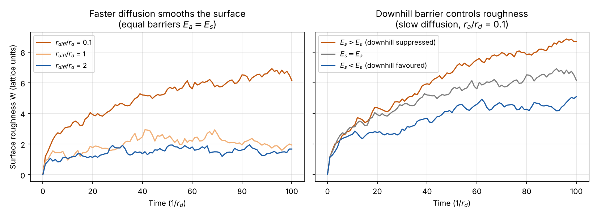

# Kinetic Monte Carlo of surface growth

A rejection-free kinetic Monte Carlo (KMC) simulation of one-dimensional thin-film growth by molecular deposition and surface diffusion, written in Python.

## Model

The surface is a 1D lattice of N = 50 sites with periodic boundary conditions, described by integer column heights h<sub>i</sub>. Two kinds of events compete:

- **Deposition** on any site, at rate r<sub>d</sub>
- **Diffusion** of the top particle to a neighbouring column, thermally activated with rate r = ν exp(−E / k<sub>B</sub>T):
  - horizontal moves (same level), barrier E<sub>a</sub>
  - downhill moves, barrier E<sub>s</sub> (a step-edge, Ehrlich–Schwoebel-like barrier)

At each step the code builds the list of all possible events, picks one with probability proportional to its rate, and advances the clock by Δt = −ln(u)/R, where R is the total rate (n-fold way / Gillespie algorithm). Every step executes an event, so no moves are wasted on rejections.

## Results



| Scenario | r<sub>a</sub>/r<sub>d</sub> | r<sub>s</sub>/r<sub>d</sub> | Roughness W at t = 100 |
| --- | --- | --- | --- |
| E<sub>a</sub> = E<sub>s</sub>, slow diffusion | 0.1 | 0.1 | 6.15 |
| E<sub>a</sub> = E<sub>s</sub>, intermediate | 1.0 | 1.0 | 1.91 |
| E<sub>a</sub> = E<sub>s</sub>, fast diffusion | 2.0 | 2.0 | 1.67 |
| E<sub>s</sub> > E<sub>a</sub> (by 1 k<sub>B</sub>T) | 0.1 | 0.037 | 8.72 |
| E<sub>s</sub> < E<sub>a</sub> (by 1 k<sub>B</sub>T) | 0.1 | 0.272 | 5.12 |

- The mean height grows as h ≈ r<sub>d</sub> t in every case. Diffusion only redistributes material; it does not create any.
- **Faster diffusion gives smoother films.** When particles can move before they are buried, they fill valleys, and the roughness drops by a factor of almost four.
- **The downhill barrier controls the morphology.** A larger step-edge barrier (E<sub>s</sub> > E<sub>a</sub>) traps particles on top of mounds and gives the roughest film. A smaller one lets them relax into valleys. This is the same mechanism that decides between smooth layer-by-layer growth and mound formation in real thin-film deposition.

## Files

| File | Content |
| --- | --- |
| `surface_kmc.py` | KMC engine: event list, rate-weighted event selection, time stepping |
| `surface_analysis.py` | JSON output and plotting routines |
| `run_scenarios.py` | Runs the five scenarios and generates all results |
| `results/` | One JSON file per scenario (parameters, time series, final profile) and the plots |

## Run

```bash
python run_scenarios.py
```

Requires `numpy` and `matplotlib`. The random seed is fixed, so the results above are reproducible.
