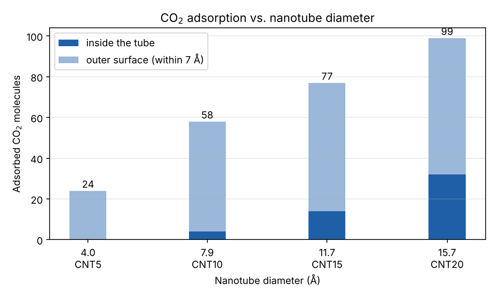

# CO₂ adsorption in carbon nanotubes

An automated Python pipeline that analyses molecular-dynamics snapshots of CO₂ around single-walled carbon nanotubes (CNTs) of four different diameters.

For every `Nanotube_data/CNT*.xyz` file, the notebook:

1. reads the XYZ file, tolerating missing files and malformed lines
2. separates nanotube carbons (`C`) from the CO₂ molecules, each represented by its central atom `Cx`
3. checks that the tube axis is along z instead of assuming it
4. computes the tube centre, radius, diameter, length and internal volume
5. classifies each CO₂ molecule as adsorbed **inside** the tube, adsorbed on the **outer surface** (within 7 Å), or free
6. collects all systems in `results.csv`

## Results

| System | Diameter (Å) | CO₂ in box | Inside | Outer surface | Total adsorbed |
| --- | --- | --- | --- | --- | --- |
| CNT5 | 4.0 | 100 | 0 | 24 | 24 (24 %) |
| CNT10 | 7.9 | 150 | 4 | 54 | 58 (39 %) |
| CNT15 | 11.7 | 150 | 14 | 63 | 77 (51 %) |
| CNT20 | 15.7 | 150 | 32 | 67 | 99 (66 %) |

- **The narrowest tube (4 Å) holds no CO₂ inside.** Its radius of 2 Å is measured to the carbon nuclei. Once the carbon atoms' own size (van der Waals radius ≈ 1.7 Å) is subtracted, almost no free space is left, so CO₂ can only adsorb on the outside.
- **Adsorption grows with diameter**, both inside (more volume) and outside (more surface area). The adsorbed fraction rises from 24 % to 66 % of all molecules.
- Most molecules sit on the outer surface in every system. Only in the widest tube does the inside hold a substantial share, about a third of the total.

## Run

Open `adsorption_analysis.ipynb` in Jupyter and run all cells. Requires `numpy`, `pandas` and `matplotlib`.
