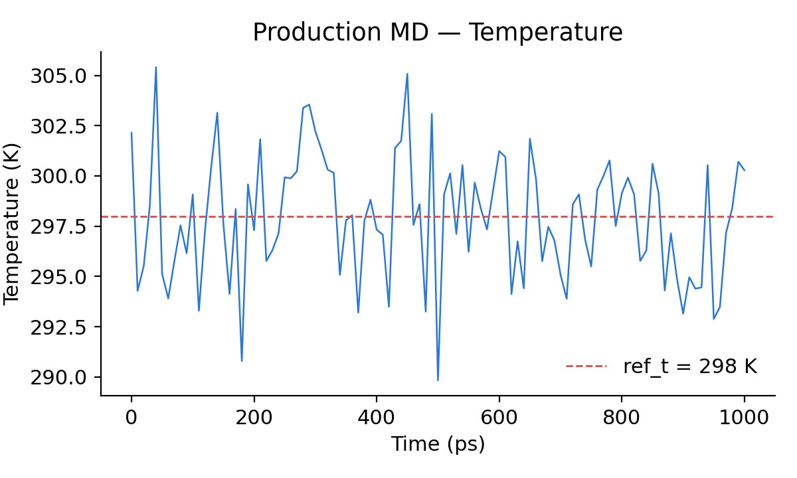
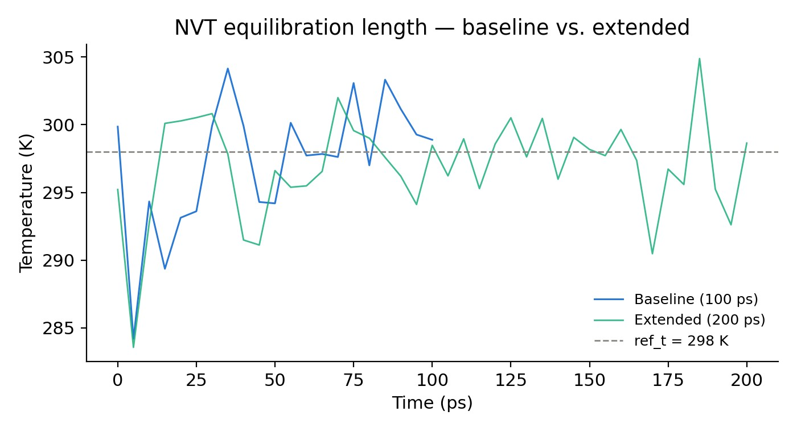

# Molecular dynamics of Chignolin with GROMACS

All-atom molecular dynamics of the 10-residue miniprotein **Chignolin** (GYDPETGTWG, PDB 5AWL) in explicit water, run with GROMACS 2026.3. I ran the full workflow, checked every stage against the physics it should reproduce, and tested three parameter changes against the baseline.

## System and workflow

| Component | Value |
| --- | --- |
| Force field / water | AMBER03 / TIP3P |
| Atoms | 8931 (166 protein, 2921 waters, 2 Na⁺) |
| Electrostatics | PME, 1.2 nm real-space cutoff |
| Constraints / time step | LINCS (H-bonds), SETTLE (water) / 2 fs |
| Temperature / pressure | 298 K (V-rescale) / 1 bar |

**Pipeline:** topology (`pdb2gmx`) → cubic box and solvation → neutralisation with Na⁺ → steepest-descent minimisation → 100 ps NVT → 500 ps NPT (both with position restraints) → 1 ns unrestrained production.

## Validation: does the system really reach equilibrium?

In a thermalised system, the equipartition theorem fixes the size of the temperature fluctuations: σT = T √(2/Ndof) ≈ **3.14 K** for this system (Ndof = 17 954). I used this as a quantitative test at every stage.

| Stage | Temperature RMSD (K) | Ratio to theory |
| --- | --- | --- |
| NVT, 100 ps (baseline) | 9.85 | 3.1× |
| NVT, 200 ps (extended) | 7.55 | 2.4× |
| Production, 1 ns | **3.11** | **0.99×** |

The baseline NVT run is still relaxing: its fluctuations are three times larger than equilibrium allows, and it warms by 3.8 K between its first and second halves. After the full NVT + NPT protocol, the production run matches the equipartition prediction to within 2 %.

## Parameter study

| # | Change | Motivation | Outcome |
| --- | --- | --- | --- |
| 1 | NVT length 100 → 200 ps | Fluctuations 3× above equipartition | Systematic drift reduced about 3× (3.84 → 1.23 K) |
| 2 | Separate thermostats for protein and solvent | Test for a hot-solvent / cold-solute artefact | Protein equilibrates fast (1.2× theory). The solvent, 98 % of the degrees of freedom, stays at 3.1×, so the excess noise is slow solvent relaxation, not a coupling artefact |
| 3 | NPT barostat Parrinello–Rahman → C-rescale | GROMACS warns that Parrinello–Rahman can be unstable with position restraints | Same accuracy, 4× smaller volume drift, warning removed |
| 4 | `DispCorr = No` → `EnerPres` | The template was written for CHARMM/OPLS, while AMBER03 expects a long-range dispersion correction | Identified, not yet re-run |

I also fixed an oversubscribed thread configuration (16 threads on a 2-CPU container), which **doubled performance** from 16 to about 31 ns/day.

## Files

| File | Content |
| --- | --- |
| `input/*.mdp` | GROMACS parameter files for every stage, including the three modified versions (`nvt_long`, `nvt_tcgrps`, `npt_crescale`) |
| `report.pdf` | Full report: methods, all figures, statistics and the commands to reproduce every run |
| `*.png` | Selected figures from the report |

Trajectories are not included because of their size. All commands are listed in Section 7 of the report.
