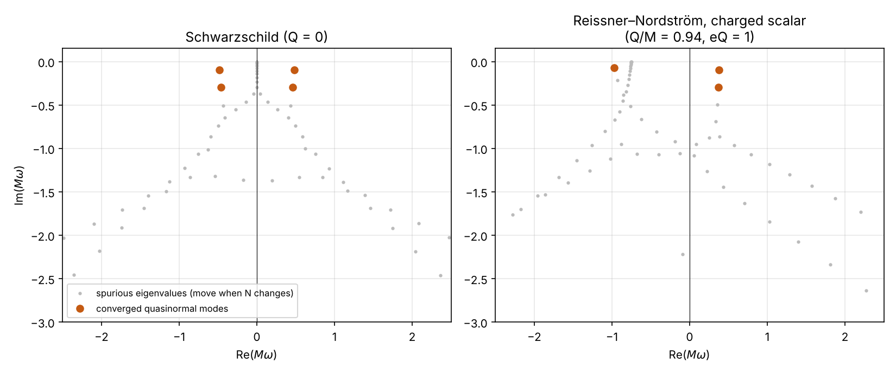
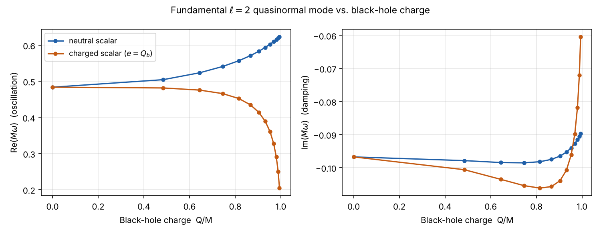

# Quasinormal modes of black holes

*Research internship, Instituto de Física Teórica (IFT UAM-CSIC), Madrid, March–May 2025*

A perturbed black hole "rings down" with a discrete set of complex frequencies, its **quasinormal modes** (QNMs): the real part is the oscillation frequency and the imaginary part the damping rate. These are the frequencies seen in the final stage of gravitational-wave signals. This project computes the QNMs of a scalar field around uncharged (Schwarzschild) and charged (Reissner–Nordström) black holes.

## Method

1. **Symbolic geometry (SageMath manifolds).** Lorentzian metric in ingoing Eddington–Finkelstein coordinates with compactified radius u = 1/r, the Einstein and Maxwell equations, and the charged Klein–Gordon equation.
2. **Boundary conditions from asymptotic analysis.** Waves fall into the horizon and travel outwards at infinity. The asymptotic behaviour is factored out, R = eα/u uβ ψ(u), so that ψ is regular on the whole domain.
3. **Chebyshev spectral collocation.** The radial equation becomes a quadratic eigenvalue problem in ω, which is linearised and solved as a generalised eigenvalue problem.
4. **Convergence test.** Only eigenvalues that are stable when the resolution changes are kept as physical modes. The rest are discretisation artefacts.

## Results

**Validation (Schwarzschild, ℓ = 2):**

| Mode | This work (M ω) | Literature |
| --- | --- | --- |
| Fundamental | 0.48364 − 0.09676 i | 0.48364 − 0.09677 i |
| First overtone | 0.46385 − 0.29560 i | 0.46385 − 0.29560 i |

**Charged black hole (Q/M = 0.94) with a charged scalar field:** the fundamental modes are M ω = 0.3753 − 0.0986 i and −0.9682 − 0.0689 i. All modes decay, so the black hole is stable against this perturbation. The charge coupling breaks the ω → −ω\* symmetry of the neutral spectrum.

As the black hole approaches extremality, the oscillation frequency rises for a neutral field and drops strongly for a charged one.

## Files

| File | Content |
| --- | --- |
| `schwarzschild_scalar_EF.ipynb` | Scalar QNMs of Schwarzschild: derivation and 192-bit spectral solver (SageMath + mpmath) |
| `reissner_nordstrom_background.ipynb` | Einstein–Maxwell solution in EF coordinates: metric, gauge field, extremal limit (SageMath) |
| `rn_charged_scalar_qnm.ipynb` | Charged-scalar QNMs of Reissner–Nordström: equation, asymptotics, solver, validation and results (Python: SymPy, NumPy, SciPy) |
| `mpchebdif.sage` | Arbitrary-precision Chebyshev differentiation matrices |

The last notebook revisits the numerical part of the internship work. It corrects the covariant wave equation, regularises the equation before discretisation and checks convergence. Its notes section lists the changes.
